# Git Repo & Branch Explorer

A Visual Studio-unified **Git Repository** window, natively for VS Code, Cursor, Windsurf, and VSCodium.

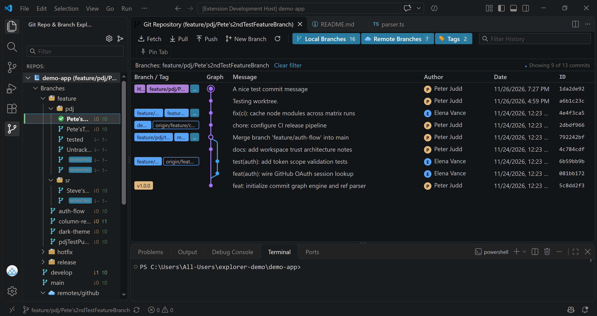

*Unified repository timeline, branch tree, commit details, and Git context actions.*

## Key Highlights

- Native Activity Bar sidebar plus a far-left, synchronized editor timeline.
- Multi-repository workspace discovery with a **REPOS:** switcher and repository-aware blame and remote resolution.
- **Find & Clone Repository** for GitHub, GitHub Enterprise, Azure DevOps, and direct repository URLs.
- Git Worktree management in the sidebar, including **WORKTREE** badges and a live-destination **Create Worktree** modal.
- **Cherry-Pick into Worktree** for eligible commits, including backports, with dirty-worktree protection and Open in New Window actions.
- Stash browsing and management, with repository and branch-aware stash creation plus selective tracked/untracked stashing.
- **Stash File…** from the Explorer or editor context menu, including tracked, untracked (`-u`), and renamed files.
- Tag creation, remote push, and local delete workflows for annotated and lightweight tags.
- Structured **author:**, **hash:**, and debounced **file:** history filters.
- File and line history, revision stepping, and Ctrl/Cmd+click OLDER/NEWER two-revision compare.
- **Compare References** for branches and commits, with Swap, ahead/behind summary, and Changed Files / Commits tabs.
- Inline commit and file diff stats, Amend, pre-checked Patch, and remote file/line URL actions.
- Non-intrusive, cache-only **Symbol Insights** with five independently configurable blame settings.
- Hierarchical local and remote branch folders with optional, persisted folder branch counts.
- Multi-lane SVG commit graph with draggable, persisted column widths and virtualized 500-commit background pagination.
- Responsive **CHECKED OUT** pill that never obscures branch names.
- Customizable VS Code `↓ ↑` / Visual Studio `↑ ↓` tracking counters.
- Safe Reset `--mixed` / `--hard` modes and Merge-Commit Revert `-m 1`.
- Read-only commit inspection and trust-gated side-by-side `vscode.diff` views.
- One-click **Open File** beside each changed file, while retaining the row's side-by-side diff action.
- Git Graph plus GitHub, GitHub Enterprise Cloud (`.ghe.com`), Azure DevOps, GitLab and Bitbucket browser integration.
- Default-branch guards for **Create Pull Request in Browser** and **Push and Open PR in Browser**.
- Cloud remotes use a sky-blue cloud, while local-drive remotes use a distinct drive icon, `(local)` marker and full-path tooltip.
- Subtle inline Git blame and status-bar summaries, with an on-demand blame gutter and bounded, trust-gated caching.

## Feature Walkthrough

### Context menus

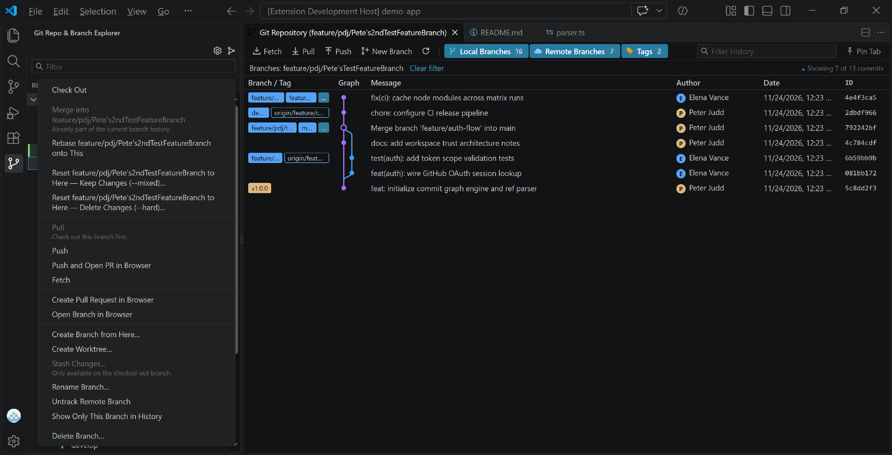

*Branch context actions include Merge, Rebase, Pull/Push, Worktree-aware operations, stash workflows, and guarded destructive actions.*

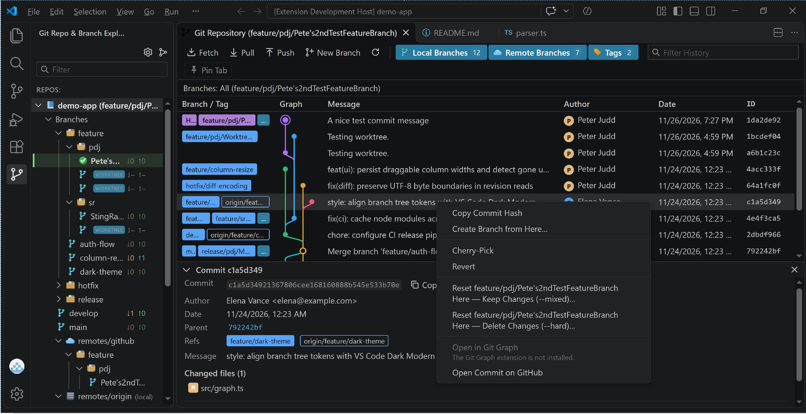

*Commit-row actions include Copy Commit Hash, branch creation, Cherry-Pick, Revert, Git Graph, and browser integration.*

### Multi-repository workspaces, worktrees and stashes

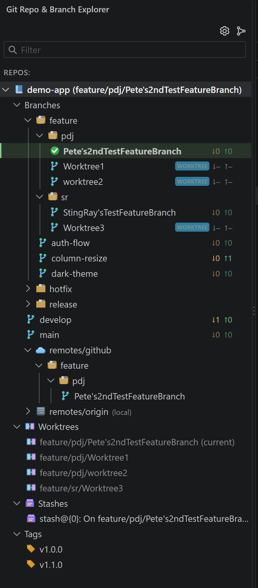

*The `REPOS:` switcher discovers repositories in the workspace; Worktrees and Stashes stay grouped by repository.*

Use the **Create Worktree** action to add a linked checkout from the current repository.

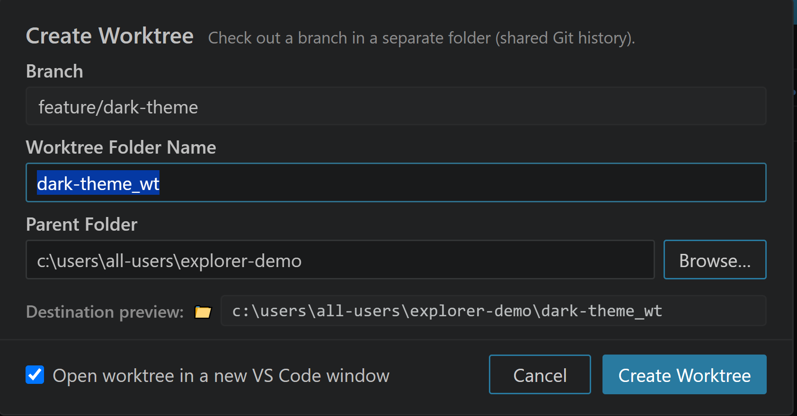

*The Create Worktree modal validates the branch and destination, with a live preview and Open, Remove, and Copy Path actions for existing worktrees.*

### Stash inspection

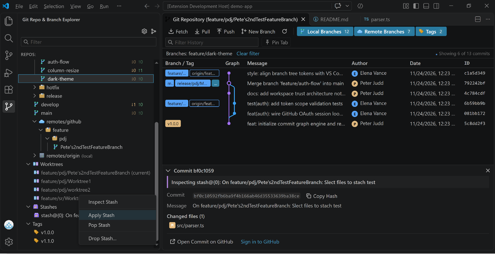

*Inspect a stash in Commit Details, then Apply, Pop, or quietly Drop it from the stash menu.*

### Commit details and diffs

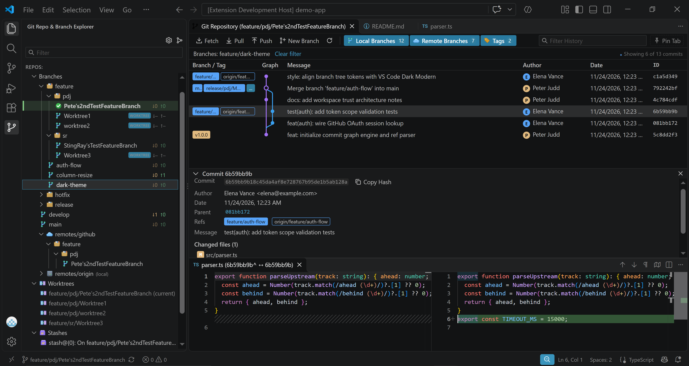

Commit Details and the Changed Files drawer support one-click **Open File** access to the working-tree file (with a read-only revision fallback) alongside trust-gated side-by-side `vscode.diff` inspection.

### Git Blame & Visual Studio Annotate

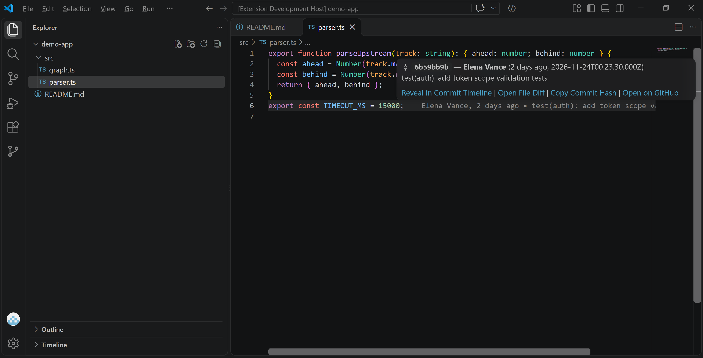

*Inline blame stays close to the active line and remains repository-aware in multi-repository workspaces.*

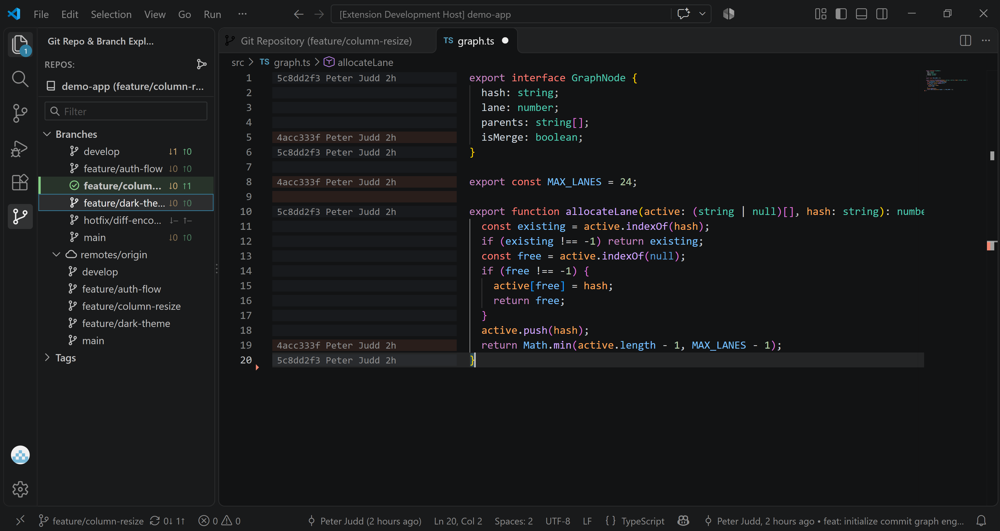

*The optional gutter view adds Visual Studio-style blame annotations beside the file, on demand.*

Subtle active-line inline Git blame and a Status Bar summary can be toggled with **Toggle Inline Git Blame** and configured in Settings. The blame hover card provides **Reveal in Commit Timeline**, **Open File Diff**, **Copy Commit Hash**, and **Open on GitHub** (when a GitHub remote is available). Enable an on-demand **Toggle File Blame Gutter (Annotate)** from the Command Palette or editor right-click menu. This stays free of per-function CodeLens bloat, uses a bounded per-file LRU cache, and is gated by Workspace Trust.

**Symbol Insights** are optional and non-intrusive: the master switch defaults on, hover insights default on, while declaration inline text, the status-bar tooltip, and cache-only CodeLens default off. The existing blame cache is reused, so enabled modes add zero extra `git blame` processes.

### Repository menu options

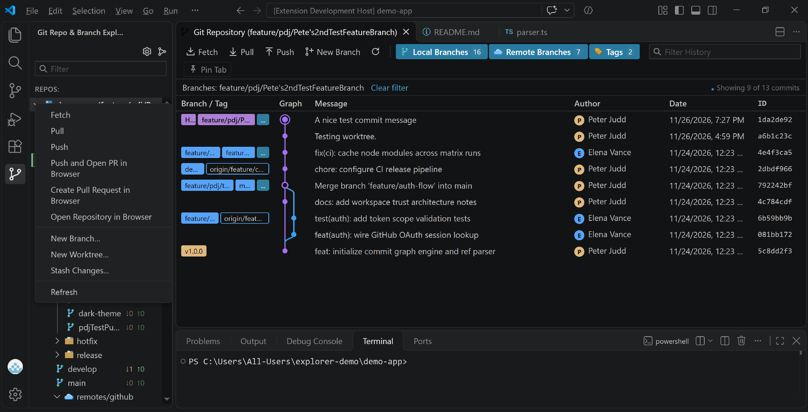

Customize the **CHECKED OUT** pill, show or hide folder branch counts, and switch counters between VS Code `↓ ↑` or Visual Studio `↑ ↓`.

## Quick Install

- **VS Code Marketplace:** [Install Git Repo & Branch Explorer](https://marketplace.visualstudio.com/items?itemName=juddersoft.git-repo-and-branch-explorer)
- **Open VSX:** [Install Git Repo & Branch Explorer](https://open-vsx.org/extension/juddersoft/git-repo-and-branch-explorer)

## Security & Workspace Trust

Extension Git actions run only in trusted workspaces, with `protocol.ext.allow=never`. Git uses argument arrays with zero shell interpolation, and the extension collects zero telemetry.

## Features

### Branch, remote and tag tree in the Activity Bar
- Workspace discovery adds a **REPOS:** switcher for repositories under the open workspace. Repository selection keeps timeline, branch, remote, worktree, stash and blame context synchronized, and blame hover plus hosted-remote links resolve against the repository that owns the open file.
- Local branches, `remotes/<name>` groups and tags in one filterable tree, shown directly in the Primary Side Bar. A **Repos:** heading sits above the repository row (`<repo> (<branch>)`), and local branches are listed directly under **Branches**.
- Local and remote branches containing `/` are organized into collapsible, alphabetically sorted folder trees with indent guides. Manual expansion is persisted, checked-out branch ancestors expand automatically, and the repository context menu can persistently show or hide folder branch counts.
- Selecting a ref, isolating branches (eye button) and the busy status of Git operations are mirrored between the sidebar tree and the editor timeline.
- The **checked-out** branch is unmistakable: green accent bar, check icon, bold name and a compact **Checked Out** badge. The badge shrinks as the sidebar narrows, disappears when it would be unreadable, and can be turned off from the repository row's right-click menu (**Hide "Checked Out" Badge**).
- Every local branch shows explicit **↓ (commits to pull) / ↑ (commits to push)** counts in VS Code's default order, `↓0 ↑0` when up to date. The repository row's right-click menu can persistently switch to Visual Studio's `↑ ↓` order. A branch with no upstream shows dashes, and a deleted upstream retains the warning tooltip instead of claiming it is up to date.
- **Single-click** any branch, remote branch or tag to *inspect* it: it is highlighted with the list-selection colours and the history table, breadcrumb and "Showing N of M commits" indicator focus on the commits reachable from it. **Clear filter** returns to the full history.
- **Double-click** (or press <kbd>Enter</kbd> on) a non-current local branch to check it out. The eye button still isolates several branches at once.
- **Right-click** a branch, remote branch, tag or commit for a viewport-clamped, scrollable context menu (<kbd>Shift</kbd>+<kbd>F10</kbd> / the Menu key work too). Inapplicable actions are disabled and say why.

### Context menus and Git operations
- Repository (right-click the repository row, or focus it and press <kbd>Shift</kbd>+<kbd>F10</kbd> / <kbd>Enter</kbd>): **Fetch**, Pull, Push/Publish, New Branch…, Refresh. Local-only repositories offer **Publish Repository / Add Remote…**. Fetch only contacts remotes that at least one local branch tracks (with prune); local branches without an upstream are skipped without failing, and a summary reports what was fetched and skipped.
- Local branch: Check Out, Merge into current, Rebase current onto this, Pull, Push/Publish (including branches that are not checked out), Push and Open PR, Open Branch, Create Pull Request, Fetch, Create Branch from Here, Rename Branch, Untrack Remote Branch, Show Only This Branch, Delete Branch (with an irreversible-action warning and a force-delete prompt when Git says it is not fully merged).
- Remote branch: Check Out as Local Tracking Branch, Merge, Rebase, Create Branch from Here, Open Branch, Create Pull Request.
- Tag: Create Branch from Here, Merge, Rebase.
- Commit: Copy Commit Hash, Create Branch from Here, Cherry-Pick, Revert, Open in Git Graph, Open Commit in Browser.
- Merge, Rebase and Delete are disabled for the checked-out branch or a detached HEAD; Pull is disabled without an upstream or for a branch that is not checked out; Cherry-Pick is disabled for commits already in the current history; merge commits cannot be cherry-picked or reverted from the view.
- Rebase and Delete ask for confirmation. If a merge, rebase, cherry-pick or revert stops on conflicts, the error message tells you to resolve them in the Source Control view or abort in a terminal.

### Git worktrees
- The **Worktrees** sidebar section lists the main checkout and linked worktrees for the selected repository. Worktree branches use a **WORKTREE** badge so linked checkouts are easy to distinguish.
- **Create Worktree** opens a modal with a live destination preview, branch selection or validation, and safe checkout behavior. Existing worktrees provide Open, Remove, and Copy Path actions.

### Stash management
- The **Stashes** sidebar section lists stashes for the selected repository. Use the repository context menu or the stash action on the checked-out branch to run **Stash Changes…**.
- Stash creation supports tracked changes, untracked files with `-u`, and selective multi-file stashing. Apply, Pop, Inspect, and Drop actions are available; Drop confirms through a quiet action rather than a disruptive modal.
- **Inspect Stash** in Commit Details shows the stash contents and changed files, making it possible to review, apply, pop, or drop the stash without leaving the timeline.
- **Git Repo & Branch Explorer: Stash File…** is available in the Explorer and editor context menus for tracked, untracked, and renamed files.

### Find and clone repositories
- Run **Git Repo & Branch Explorer: Clone Repository…** from the Command Palette or use the Clone Repository action.
- Browse GitHub (github.com), GitHub Enterprise (`*.ghe.com` / Server), or Azure DevOps organizations and repositories, or enter a repository URL directly. The destination folder is validated before cloning.

### Tags and cherry-picks
- Right-click a commit to **Create Tag…**, choosing an optional message for an annotated tag or leaving it blank for a lightweight tag.
- Right-click a tag for **Push Tag to Remote…** or **Delete Tag…**. Push uses an explicit `refs/tags/` destination; local delete uses a quiet confirmation and does not delete the remote tag.
- Right-click a non-merge commit to **Cherry-Pick into Worktree…**. It is available for commits already in the current branch history for backporting, guarded against dirty destinations, and offers **Open Worktree in New Window**.

### Multi-lane SVG commit graph
- The history table has **Branch / Tag**, **Graph**, **Message**, **Author**, **Date** and **ID** columns. Drag any column divider to resize it (double-click a divider to reset that column); widths are remembered.
- Branches, merges and octopus merges are drawn as coloured lanes that stay readable on light and dark themes.
- Lanes are recycled after merges, and lanes that lead to commits outside the visible list end cleanly.
- Filter the history by message, author, hash or ref name.
- Filter History also supports structured `author:`, `hash:`, and debounced `file:` tokens, including quoted phrases in file filters.
- History is loaded in append-only 500-commit chunks and virtualized at a fixed `26px` row height, so repositories are no longer limited to the first 500 commits and scrolling keeps the SVG graph responsive.
- The **Local Branches**, **Remote Branches** and **Tags** toggles control which ref labels appear in the Branch / Tag column. Active toggles are filled with the button colour and show how many refs of that kind exist; a status line explains what is hidden or missing ("Hiding tags (3)", "No tags in this repository"). Toggles hide labels only, never commits.

### Live Git actions
- **Fetch** (all remotes, with prune), **Pull** and **Push** from the toolbar.
- Pushing any local branch without an upstream (or with a deleted upstream) asks which remote to use and shows the exact hosted URL or local drive path before creating the remote branch. Renamed branches can publish the new name or continue pushing to the existing old upstream branch.

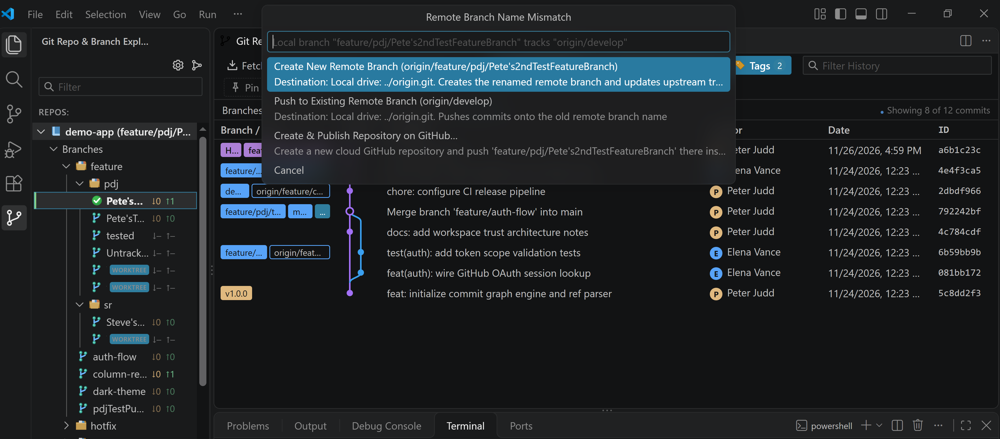

*When a branch has no remote branch yet, choose the remote and publish destination before pushing.*

- Repositories with no remote, or a local-only remote, can be published through a silent guided flow that creates a Personal or Organization GitHub repository, creates a local bare remote on disk, or attaches an existing remote URL.
- **Push and Open PR in Browser** opens a pre-filled pull-request page; regular feature-branch pushes offer the same action in a non-blocking notification.
- **Create Branch** uses an in-webview dialog that validates the name as you type, offers checkout and remote-tracking options, and safely handles dirty working-tree changes.
- Every action shows a progress notification and refreshes the view when it finishes.

### Commit details and file diffs
- Select a commit to see its full message and the list of changed files with **A** (added), **M** (modified), **D** (deleted) and **R** (renamed) badges.
- Click a file row to open VS Code's native read-only diff of the parent revision against the commit, or use the inline **Open File** button directly beside the name to open the working-tree file. Deleted or missing files open from the appropriate read-only commit revision.
- Commit Details includes inline `+N` / `-N` and Binary diff stats with per-commit totals. Right-click commit rows for **Amend Last Commit…**, **Create Patch…**, and **Apply Patch…**.
- **Apply Patch…** pre-validates patches with `git apply --check` before applying them.
- **Git Repo & Branch Explorer: Copy Remote File/Line URL** is available from editor and Explorer context menus. It supports GitHub, GitHub Enterprise Cloud (`*.ghe.com`), Azure DevOps, GitLab, and Bitbucket.

### File, line, and reference comparison
- Use **Git Repo & Branch Explorer: View File History** and **Git Repo & Branch Explorer: View Line History** from file/editor context menus. File history follows renames with `git log --follow --name-status`; line history inspects a selection with `git log -L`.
- Use **Git Repo & Branch Explorer: Compare File with Previous Revision** from the editor title or file context menus, and **Git Repo & Branch Explorer: Open Previous File Revision** from the editor title/context menus.
- In File History, Ctrl/Cmd+click exactly two revisions to compare them. The selected rows display unmistakable **OLDER** / **NEWER** badges, and diff tab titles and pane headers identify the two revisions.
- Use **Compare with Another Reference…** from commit or branch context menus, or **Compare with <current branch>**. Reference comparison provides **Swap**, ahead/behind counts, Changed Files and Commits tabs, and `BASE <-> TARGET` diff headers.

### Git Graph and hosted-remote integration
- **Open in Git Graph** appears when the [Git Graph](https://marketplace.visualstudio.com/items?itemName=mhutchie.git-graph) extension is installed.
- Repository, branch and commit browser actions recognize GitHub, GitHub Enterprise Cloud (`.ghe.com`), Azure DevOps, GitLab and Bitbucket SSH or HTTPS remotes. Pull-request actions open each provider's pre-filled creation page.
- **Create Pull Request in Browser** and **Push and Open PR in Browser** warn and stop rather than opening a PR from the repository's default branch.
- GitHub sign-in uses VS Code's built-in authentication; the extension never stores credentials.

### Auto-refresh
- A debounced `.git` watcher refreshes the view when HEAD, branches, tags or remote refs change, including changes made in a terminal or another tool.
- Git's temporary `*.lock` files are ignored so the view never reads a half-written ref.

### SHA-1 and SHA-256 repositories
- Both 40-character SHA-1 and 64-character SHA-256 commit hashes are supported.

## Getting started

1. Open a folder that is (or is inside) a Git repository.
2. Click the **Git Repo & Branch Explorer** icon in the Activity Bar, or run **Git Repo & Branch Explorer: Open Repository Window** from the Command Palette.
3. The branch, remote and tag tree appears in the sidebar and the **Git Repository** timeline tab opens in the editor area, moved to the far left of its group. The Git Repo & Branch Explorer icon stays highlighted in the Activity Bar.
4. By default the tab closes when you switch to another sidebar view (Explorer, Search, Source Control, ...) or hide the sidebar. Click **Pin Tab** in the toolbar to keep it open; the choice is remembered. If you close the tab yourself, the **Open history timeline** button in the sidebar header brings it back.

## Commands

| Command | ID | Description |
|---|---|---|
| Git Repo & Branch Explorer: Open Repository Window | `gitRepoAndBranchExplorer.openRepository` | Opens (or focuses) the Git Repository tab. |
| Git Repo & Branch Explorer: Refresh | `gitRepoAndBranchExplorer.refresh` | Reloads branches, tags and history. |
| Git Repo & Branch Explorer: Clone Repository… | `gitRepoAndBranchExplorer.cloneRepository` | Finds and clones repositories from URLs or supported hosted providers. |
| Git Repo & Branch Explorer: Stash File… | `gitRepoAndBranchExplorer.stashFile` | Stashes the selected file from Explorer or the editor context menu. |
| Git Repo & Branch Explorer: View File History | `gitRepoAndBranchExplorer.viewFileHistory` | Opens follow-aware file history. |
| Git Repo & Branch Explorer: View Line History | `gitRepoAndBranchExplorer.viewLineHistory` | Opens line history for the selected editor lines. |
| Git Repo & Branch Explorer: Compare File with Previous Revision | `gitRepoAndBranchExplorer.compareWithPreviousRevision` | Compares the file with its previous revision. |
| Git Repo & Branch Explorer: Open Previous File Revision | `gitRepoAndBranchExplorer.openPreviousRevision` | Opens the previous file revision in the editor. |
| Git Repo & Branch Explorer: Toggle Inline Git Blame | `gitRepoAndBranchExplorer.toggleInlineBlame` | Enables or disables active-line inline blame. |
| Git Repo & Branch Explorer: Toggle File Blame Gutter (Annotate) | `gitRepoAndBranchExplorer.toggleFileAnnotate` | Toggles the on-demand Visual Studio-style blame gutter. |
| Git Repo & Branch Explorer: Apply Patch… | `gitRepoAndBranchExplorer.applyPatch` | Selects and pre-validates a patch before applying it. |
| Git Repo & Branch Explorer: Copy Remote File/Line URL | `gitRepoAndBranchExplorer.copyRemoteFileUrl` | Copies the hosted remote URL for the file or selected line. |

## Configuration

| Setting | Default | Purpose |
|---|---|---|
| `gitRepoAndBranchExplorer.blame.enabled` | `true` | Show subtle inline Git blame on the active editor line. |
| `gitRepoAndBranchExplorer.blame.ignoreWhitespace` | `false` | Ignore whitespace changes when running git blame (`-w`). |
| `gitRepoAndBranchExplorer.blame.showStatusBar` | `true` | Show the active-line Git blame summary in the status bar. |
| `gitRepoAndBranchExplorer.blame.symbolInsights.enabled` | `true` | Master switch for Git Symbol Insights: author count, commit count, and last-modified information computed from cached blame with zero extra Git processes. |
| `gitRepoAndBranchExplorer.blame.symbolInsights.hover` | `true` | Include the enclosing symbol summary in the active-line Git blame hover. |
| `gitRepoAndBranchExplorer.blame.symbolInsights.declarationInline` | `false` | Show subtle inline ghost text at symbol declaration lines. |
| `gitRepoAndBranchExplorer.blame.symbolInsights.statusBarTooltip` | `false` | Include the enclosing symbol summary in the Git blame status-bar tooltip. |
| `gitRepoAndBranchExplorer.blame.symbolInsights.codeLens` | `false` | Show cache-only, opt-in CodeLens above symbol declarations with click-to-reveal authorship. |

## Requirements

- VS Code **1.95** or later.
- The **Git CLI** installed and on your `PATH`. The extension runs your own `git` executable, so your credential helpers, SSH keys and Git configuration apply to fetch, pull and push.
- A network connection only for Fetch, Pull, Push and GitHub features.

## Security architecture

- **No shell:** Git runs with an argument array (`shell: false`), never a command string, so commit messages, branch names and file paths cannot be interpreted as shell syntax.
- **Input validation:** branch and ref names are checked against Git's ref-name rules and reject option injection (`--upload-pack=…`, `-c`), `..` traversal, control characters and globs. Commit hashes must be full 40- or 64-character hex strings. File paths in revision specs must be repository-relative with no `..` segments or absolute paths.
- **Non-interactive Git:** `GIT_TERMINAL_PROMPT=0` stops Git from hanging on a hidden password prompt, and `GIT_OPTIONAL_LOCKS=0` keeps read-only refreshes from taking the index lock. Every command has a timeout.
- **Strict webview Content Security Policy:** `default-src 'none'`, scripts only with a per-render cryptographic nonce, no `'unsafe-inline'` or `'unsafe-eval'`, and local resources limited to the extension's own `dist` and webview UI folders.
- **Validated messages:** every message from the webview is checked at runtime (type, payload shape, length limits, prototype-pollution keys) before the extension acts on it. Repository data is rendered with DOM text APIs, never as HTML.
- **Safe external links:** GitHub URLs are rebuilt from a normalized `https://github.com/<owner>/<repo>` remote and a validated hash before being opened.
- **No stored credentials:** GitHub authentication goes through `vscode.authentication`; nothing is written to disk.

## Development

```bash
npm install
npm run compile            # esbuild bundles for the extension host and the webview
npm run typecheck          # tsc --noEmit (strict)
npm test                   # Vitest unit and security tests
npm run test:coverage      # Vitest with V8 coverage (report in coverage/)
npm run test:integration   # VS Code extension-host tests (downloads VS Code on first run)
npm run package            # builds git-repo-and-branch-explorer-<version>.vsix
```

Press <kbd>F5</kbd> with the **Run Extension** launch configuration to debug in an Extension Development Host.

## Known limitations

- Older history is fetched in 500-commit background chunks as needed, so very large repositories may take longer to reach their oldest commits.
- Linked worktrees and submodules, where `.git` is a file rather than a folder, are not auto-refreshed by the watcher; use **Refresh**.

## License

[MIT](LICENSE) © 2026 JudderSoft
